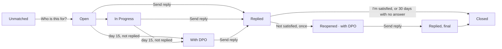

# Rights requests and grievances: design for sign-off

Status: **draft for sign-off**. Frappe v15, stock building blocks. Sample data is fictional.

Two separate things, for the person and for staff:

| | **Rights / support request** | **Grievance** |
| --- | --- | --- |
| What it is | The person uses a right: stop a use, see, correct or delete their data, name someone | A complaint that something went wrong with their data or a request |
| Law (our reading; confirm with counsel) | DPDP Act s.6(4) withdrawal, s.11 access, s.12 correction and erasure, s.14 nomination | DPDP Act s.8(10) and s.13: a way to complain, answered within the published period; the Board only after this |
| DocType | **Rights Request** (exists; narrowed) | **Grievance** (new) |
| Numbers | `RQ-00031` | `GR-00012` |
| Reply time | 30 days (Anumati Settings) | 30 days, DPO at day 15 (Anumati Settings) |
| After the reply | Closed | Person can say **Not satisfied** once; then the Board route |

Screens: self-service [sign in](img/p1-sign-in.png), [choices](img/p2-choices.png), [leave and history](img/p3-leave-history.png), [rights and grievance forms](img/g1-ask.png), [tracking](img/g2-track.png); staff [workspace](img/s0-workspace.png), [rights list](img/s1-rights.png), [grievance list](img/s1-grievances.png), [grievance form](img/s2-grievance.png), [register](img/s3-register.png).

---

## 1. Rights Request (existing DocType, changed)

**Change:** `grievance` leaves the Type list; grievances move to their own DocType. Adds a reply the person can read.

### Fields

| # | Label | Fieldname | Type | Options / notes | Screen |
| --- | --- | --- | --- | --- | --- |
| | **Tab: Request** | | | | |
| 1 | What they asked | `request_type` | Select | `withdrawal` Stop using my data · `access` Show me my data · `correction` Correct my details · `erasure` Delete my data · `nomination` Name someone to act for me. Required. In list, standard filter. **Default removed** (was grievance) | g1-ask b; s1-rights |
| 2 | Came in by | `channel` | Select | as today (field worker, slip, SMS, missed call, …, `web` = Self-service page) | s1-rights |
| 3 | Status | `status` | Select | Open · Unmatched · In Progress · Awaiting Acknowledgement · Closed · Rejected (unchanged) | s1-rights; g1-ask a |
| 4 | Received on | `received_on` | Datetime | unchanged; the clock starts here | |
| 5 | Due by | `sla_due` | Date | unchanged | g1-ask a; s1-rights |
| 6 | Subject | `subject` | Data | unchanged (auto) | |
| | Column | | | | |
| 7 | Beneficiary | `matched_principal` | Link Data Principal | unchanged | s1-rights |
| 8–11 | Match confidence, Possible matches, Assigned to, Paper-trail number | unchanged | | | |
| 12 | Resulting consent event | `linked_event` | Link | unchanged (withdrawals) | |
| | **Section: Reply** *(new)* | | | | |
| 13 | Reply to the person | `reply` | Small Text | Shown on their self-service page; sent by SMS when an approved `rights_update` template exists | g1-ask a (status line) |
| 14 | Replied on | `replied_on` | Datetime | read-only, set when the reply is sent | |
| | Sender section, Details tab | unchanged (sender hash, email, raw payload, resolution, evidence) | | | |

**Naming:** `RQ-{#####}` (unchanged).
**List columns:** ID · What they asked · Beneficiary · Came in by · Status · Due by. **Filters:** What they asked, Status, Beneficiary.
**Permissions:** unchanged (Admin and DPO full; Operator edit; Programme Manager read; Field Worker create through the API).
**Board:** the existing Kanban board stays, now rights requests only.

---

## 2. Grievance (new DocType)

**Type:** regular, not submittable (status moves on as staff work it, like Rights Request). **Module:** Anumati. **Track changes:** on. **Delete:** nobody except System Manager (a complaint record is kept).
**Naming:** `GR-{#####}`. **Title field:** `subject`. **Sort:** creation, newest first.

### Fields

| # | Label | Fieldname | Type | Options / notes | Screen |
| --- | --- | --- | --- | --- | --- |
| | **Tab: Grievance** | | | | |
| 1 | What is it about? | `category` | Select | `used_without_consent` Used without my consent · `did_not_stop` Didn't stop when I asked · `wrong_details` Wrong details · `shared_or_leaked` My data was shared or leaked · `staff_behaviour` Staff behaviour · `request_not_answered` My request was not answered · `other` Something else. Required. In list, standard filter | g1-ask c; s1-grievances; s2 |
| 2 | About request | `about_request` | Link Rights Request | Shown and required when category = request_not_answered; optional otherwise | g1-ask c; s2 ("Open RQ-00031") |
| 3 | Subject | `subject` | Data | Auto: category label + " · " + channel, unless typed | s2 title |
| 4 | In their words | `description` | Small Text | Hindi or English; required from the self-service page | g1-ask c |
| 5 | Photo or document | `evidence` | Attach | Private file; optional | g1-ask c |
| 6 | Came in by | `channel` | Select | same list as Rights Request (`web` = Self-service page) | s2 |
| | Column | | | | |
| 7 | Beneficiary | `matched_principal` | Link Data Principal | Same matching as Rights Request (by phone hash; **Who is this for?** when the number is shared) | s1-grievances; s2 |
| 8 | Status | `status` | Select | Open · Unmatched · In Progress · **With DPO** · **Replied** · **Reopened** · Closed. In list, standard filter | g1-ask a; g2-track; s1-grievances |
| 9 | Assigned to | `assigned_to` | Link User | Operator at first; the DPO after escalation | s1-grievances; s2 |
| 10 | Received on | `received_on` | Datetime | Default now; the clock starts here | s2 |
| 11 | Due by | `sla_due` | Date | received_on + `grievance_sla_days` (30) | g2-track; s1-grievances; s2 |
| 12 | Passed to the DPO on | `escalated_on` | Datetime | read-only; set by the daily check or by Not satisfied | g2-track b; s2 |
| | **Section: Outcome and reply** | | | | |
| 13 | Outcome | `outcome` | Select | `resolved` Resolved · `partly_resolved` Partly resolved · `not_upheld` Not upheld. Required to send a reply | s2 |
| 14 | What we did (internal) | `internal_note` | Small Text | Never shown to the person | s2 |
| 15 | Reply to the person | `reply` | Small Text | Required to send; shown on their page and sent by SMS | g2-track c; s2 |
| 16 | Replied on | `replied_on` | Datetime | read-only | g2-track c |
| 17 | Their answer | `person_response` | Select | `satisfied` · `not_satisfied`; read-only (set from their page or by staff for a field visit) | g2-track c |
| 18 | Answered on | `responded_on` | Datetime | read-only | |
| | **Tab: Details** | | | | |
| 19 | Possible matches | `candidates` | Small Text | read-only, IDs only (as Rights Request) | |
| 20 | Sender phone hash | `sender_hash` | Data | read-only, indexed; the number is never stored | |
| 21 | Sender email | `raised_by` | Data (Email) | for emails to the DPO | |
| 22 | Paper-trail number | `paper_trail_number` | Data | | |
| 23 | As received | `raw_payload` | Long Text | the SMS or email text | |
| | **Tab: Beneficiary's consents** | | | | |
| 24 | Consents | `consents_html` | HTML | Filled by the form script: the person's uses, on/off, with receipt codes; no phone numbers | s2 tab |

### Status flow

No Frappe Workflow: the moves are buttons on the form (Send reply) and the daily check, like the Rights Request inbox today. After a second reply, **Not satisfied** is not offered again; the page shows the Board route.

### Form buttons (Desk)

- **Send reply** (Operator, DPO): needs Outcome and Reply; sets Replied, replied_on; logs the SMS (Communication linked to the grievance, number never stored).
- **Open RQ-xxxxx** when `about_request` is set.
- **Move to rights requests** / on Rights Request **Move to grievances**: for something filed under the wrong door (creates the other record, closes this one with a link). Mainly for emails and SMS text.

### List and workspace

- **List columns:** ID · Category · About · Assigned to · Status · Due by. **Filters:** Category, Status, Assigned to. **Indicators:** Open/Reopened orange, With DPO red, Replied green, Closed grey; overdue rows red, as for requests.
- **Requests workspace** (Frappe v15 Workspace) split in two halves, each with Number Cards (open, overdue, unmatched / with DPO) and Shortcuts (list, board or register, + New). The Today "Needs attention" block counts both.

### Permissions

| Role | Read | Write | Create | Delete | Report | Notes |
| --- | --- | --- | --- | --- | --- | --- |
| Anumati DPO | ✓ | ✓ | ✓ | | ✓ | Owns escalations |
| Anumati Operator | ✓ | ✓ | ✓ | | ✓ | Works the list |
| Anumati Admin | ✓ | | | | ✓ | Read only |
| Anumati Programme Manager | ✓ | | | | ✓ | Read only |
| Anumati Field Worker | | | ✓ (API) | | | Raises from the app |
| System Manager | ✓ | ✓ | ✓ | ✓ | ✓ | |

### Automation (stock where possible)

| What | How |
| --- | --- |
| Due date, matching, subject | Controller `validate` (same helpers as Rights Request) |
| DPO at day 15 | Daily scheduler job: grievances Open/In Progress older than `grievance_escalate_after_days` (15) → status With DPO, assign the DPO (stock Assign To), Desk notification |
| Overdue alert | Stock **Notification**: "Days After" Due by, to the DPO |
| New grievance alert | Stock **Notification**: "New", to Operator and DPO |
| Auto-close | Daily job: Replied with no answer for 30 days → Closed |
| Grievance register | Script Report: counts by category, replied, median days to reply, escalated, overdue, not satisfied; date filter |

### SMS (Message Template events; need DLT approval, logged and shown on the page until then)

| Event | Text (English; Hindi too) |
| --- | --- |
| `grievance_received` | `{{ org }}: we got your grievance {{ code }}. We will reply by {{ date }}.` |
| `grievance_reply` | `{{ org }}: reply to {{ code }}: {{ reply }}. Not satisfied? Use the link on your receipt or tell a field worker.` |
| `rights_update` (exists) | Rights request received / replied |

---

## 3. Where things come in

| From | Rights / support request | Grievance |
| --- | --- | --- |
| Self-service page | **Rights / support request** form (Stop → My choices) | **Grievance** form |
| Field app | "Stop a use or leave" and the request list (see, correct, delete, nominate) | New **Grievance** button: category + their words (companion PR in `anumati_collect`) |
| SMS | `STOP…` withdrawal, `DATA` access | `HELP` and any other text, category Something else |
| Missed call | Withdrawal (unchanged) | |
| Email to the DPO | Arrives as a Rights Request (unchanged); **Move to grievances** if it's a complaint | |
| API | `rights.submit` (unchanged, types without grievance) | New `grievance.submit` (in OpenAPI) |

**Existing data:** a patch moves every Rights Request of type grievance to a new Grievance (same dates, beneficiary, text and messages), leaving a note on the old number.

## 4. Settings (Anumati Settings)

`grievance_sla_days` (30) · `grievance_escalate_after_days` (15) · existing `rights_sla_days` (30).

## 5. Build order

1. **PR 1, self-service page:** sign-in, My choices, History, Requests tab with **Rights / support request**; Rights Request reply fields.
2. **PR 2, grievance:** Grievance DocType, patch, SMS routing, escalation, notifications, register, workspace split, self-service grievance form and tracking, API; companion field-app PR.

## 6. Open questions

1. Reply time 30 days and DPO at day 15: confirm.
2. Grievances visible to Admin and Programme Manager (read only)? A staff-behaviour complaint may be about a colleague; alternative: DPO and Operator only.
3. Emails to the DPO: keep landing as rights requests (with Move), or land as grievances by default?
4. Category list: final?
