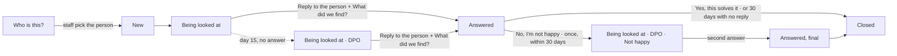

# Rights requests and grievances: design for sign-off

Status: **signed off 15 Oct 2026; built.** PR 1 (self-service page, rights requests) merged; PR 2 (grievances) built. The field app's existing **Complaint** option now files a grievance (category Something else); a category picker in the app is a follow-up. Frappe v15, stock building blocks. Sample data is fictional.

Two separate things, for the person and for staff:

| | **Rights / support request** | **Grievance** |
| --- | --- | --- |
| What it is | The person uses a right: stop a use, see, correct or delete their data, name someone | A complaint that something went wrong with their data or a request |
| Law (our reading; confirm with counsel) | DPDP Act s.6(4) withdrawal, s.11 access, s.12 correction and erasure, s.14 nomination | DPDP Act s.8(10) and s.13: a way to complain, answered within the published period; the Board only after this |
| DocType | **Rights Request** (exists; narrowed) | **Grievance** (new) |
| Numbers | `RQ-00031` | `GR-00012` |
| Reply by | 30 days | 30 days; the DPO takes over at day 15 |
| After the answer | Closed | The person says whether it solved it; if not, back to the DPO once, then the Board route |

Screens: self-service [sign in](img/p1-sign-in.png), [choices](img/p2-choices.png), [leave and history](img/p3-leave-history.png), [rights and grievance forms](img/g1-ask.png), [conversation and answer](img/g2-track.png); staff [Grievances page](img/s0-workspace.png), [rights list](img/s1-rights.png), [grievance list](img/s1-grievances.png), [grievance form](img/s2-grievance.png), [register](img/s3-register.png).

---

## 0. Plain words (final, 15 Oct)

The status says **whose turn it is**. Messages go back and forth without changing it, except as below.

| Stored value | Staff see | Person sees | Hindi | Whose turn |
| --- | --- | --- | --- | --- |
| `new_request` | Received | Received | प्राप्त हुआ | Staff |
| `who_is_this` | Who is this? | Received | यह कौन है? | Staff (match the person) |
| `working_on_it` | Working on it | Working on it | हम देख रहे हैं | Staff |
| `waiting_for_person` | Waiting for the person | Waiting for your reply | व्यक्ति के जवाब का इंतज़ार | Person |
| `waiting_for_partners` | Waiting for partners *(rights only)* | Waiting for partners | साझेदारों का इंतज़ार | Partners |
| `request_answered` | Answered | Answered | जवाब दिया | Person (grievance: is it solved?) |
| `request_closed` | Closed | Closed | बंद | — |
| `cannot_do` | Can't do this *(rights only)* | Can't do this | नहीं हो सकता | — |

Moves: staff **Send update** keeps *Working on it*; **Ask a question** → *Waiting for the person*; **Send final answer** → *Answered*; whenever the person writes, it goes back to *Working on it*. Flags next to the status: **DPO**, **Not happy**, **Late**.

**Outcome** (grievance, chosen with the final answer; the person sees the sentence):

| Stored value | Staff choose | Person sees |
| --- | --- | --- |
| `put_right` | Complaint was right: put right | You were right. We have put it right. |
| `partly_put_right` | Partly right: partly put right | You were partly right. We have put that part right. |
| `no_problem_found` | No problem found | We checked and found no problem. |

The person answers "Yes, this solves it" / "No, I'm not happy with this".

---

## 1. Rights Request (existing DocType, changed)

**Changes:** `grievance` leaves the Type list (grievances get their own DocType); statuses become the plain words above; the person and staff talk in one conversation.

### Fields

| # | Label | Fieldname | Type | Options / notes | Screen |
| --- | --- | --- | --- | --- | --- |
| | **Tab: Request** | | | | |
| 1 | What they asked | `request_type` | Select | `withdrawal` Stop using my data · `access` Show me my data · `correction` Correct my details · `erasure` Delete my data · `nomination` Name someone to act for me. Required; no default | g1-ask b; s1-rights |
| 2 | Came in by | `channel` | Select | as today; `web` shows as "Self-service page" | s1-rights |
| 3 | Status | `status` | Select | the section 0 statuses (patch maps the old values) | s1-rights; g1-ask a |
| 4 | Received | `received_on` | Datetime | unchanged; the clock starts here | |
| 5 | Reply by | `sla_due` | Date | unchanged (label only) | g1-ask a; s1-rights |
| 6 | Subject | `subject` | Data | unchanged (auto) | |
| | Column | | | | |
| 7 | Beneficiary | `matched_principal` | Link Data Principal | unchanged | s1-rights |
| 8 | Raised by | `raised_by_role` | Select | *new*: `self` · `guardian` · `nominee` · `field_worker` · `staff`. A guardian can act for a child | |
| 9–12 | Match confidence, Possible matches, Assigned to, Paper-trail number | unchanged | | | |
| 13 | Resulting consent event | `linked_event` | Link | unchanged (withdrawals) | |
| | **Section: Answer** *(new)* | | | | |
| 14 | Answer to the person | `answer` | Small Text | Shown on their page; the SMS only says there is an answer | g1-ask a |
| 15 | Answered on | `answered_on` | Datetime | read-only | |
| | Conversation | Frappe **Communication** | | Messages from their page and our replies, on the form timeline (stock) | |
| | Sender section, Details tab | unchanged | | | |

**Naming:** `RQ-{#####}`. **List columns:** ID · What they asked · Beneficiary · Came in by · Status · Reply by. **Filters:** What they asked, Status, Beneficiary. **Permissions:** unchanged. **Board:** the existing Kanban board, rights requests only.

---

## 2. Grievance (new DocType)

**Type:** regular, not submittable. **Module:** Anumati. **Track changes:** on. **Delete:** nobody except System Manager. **Naming:** `GR-{#####}`. **Title field:** `subject`. **Sort:** newest first.

### Fields

| # | Label | Fieldname | Type | Options / notes | Screen |
| --- | --- | --- | --- | --- | --- |
| | **Tab: Grievance** | | | | |
| 1 | What is it about? | `category` | Select | `used_without_consent` Used without my consent · `did_not_stop` Didn't stop when I asked · `wrong_details` Wrong details · `shared_or_leaked` My data was shared or leaked · `staff_behaviour` Staff behaviour · `request_not_answered` My request was not answered · `other` Something else. Required | g1-ask c; s1-grievances; s2 |
| 2 | Which request? | `about_request` | Link Rights Request | Required when "My request was not answered"; optional otherwise | g1-ask c; s2 |
| 3 | Subject | `subject` | Data | Auto from the category, unless typed | s2 title |
| 4 | In their words | `description` | Small Text | Hindi or English | g1-ask c |
| 5 | Photo or document | `evidence` | Attach | Optional; stored encrypted like consent evidence | g1-ask c |
| 6 | Came in by | `channel` | Select | same list as Rights Request | s2 |
| | Column | | | | |
| 7 | Beneficiary | `matched_principal` | Link Data Principal | Same matching as Rights Request ("Who is this?" for shared phones) | s1-grievances; s2 |
| 8 | Raised by | `raised_by_role` | Select | as Rights Request | |
| 9 | Status | `status` | Select | the section 0 statuses (no waiting_for_partners or cannot_do) | all |
| 10 | Assigned to | `assigned_to` | Link User | Operator first; the DPO from day 15 | s1-grievances; s2 |
| 11 | Received · Reply by | `received_on`, `sla_due` | Datetime, Date | reply by = received + 30 days | s2 |
| 12 | With the DPO since | `dpo_since` | Datetime | read-only; shows the **DPO** flag | s0; s2 |
| | **Section: Answer** | | | | |
| 13 | Outcome | `outcome` | Select | put_right · partly_put_right · no_problem_found (section 0). Required with the final answer | s2 |
| 14 | What we did (internal) | `internal_note` | Small Text | never shown to the person | s2 |
| 15 | Did it solve it? | `person_says` | Select | `solved` · `not_happy`; read-only (from their page, or staff after a visit). `not_happy` shows the **Not happy** flag | g2-track c |
| 16 | Said on | `person_said_on` | Datetime | read-only | |
| | Conversation | Frappe **Communication** | | Their messages from the page and our replies; the person sees the same thread | g2-track b, c; s2 |
| | **Tab: Details** | | | | |
| 17–21 | Possible matches, Sender phone hash, Sender email, Paper-trail number, As received | as Rights Request | | the number itself is never stored | |
| | **Tab: Beneficiary's consents** | | | | |
| 22 | Consents | `consents_html` | HTML | the person's uses, on/off, with receipt codes | s2 |

### How it moves

No Frappe Workflow; the moves come from **Reply to the person**, the person's buttons and a daily check. After the second answer the page shows the Board route instead of "No, I'm not happy".

### Conversation (both DocTypes)

- **Person → us:** "Write to us" on their page adds a message (a received Communication, linked to the request, no phone number).
- **Us → person:** **Reply to the person** (a dialog: message, and for grievances "What did we find?" when it's the answer) adds a sent Communication and, if it's the answer, sets Answered.
- **SMS:** a short "there is a reply, see it at the link or ask a field worker" (DLT variables are short, so the reply text itself is never sent by SMS).
- **Desk:** the thread shows on the form timeline (stock), so nothing new to learn.

### Form buttons (Desk)

**Reply to the person** · **Open RQ-xxxxx** (when linked) · **Move to rights requests** (and **Move to grievances** on a rights request) for anything that came in through the wrong door.

### Desk navigation

Under **Requests** in the sidebar, two entries, each its own page (stock nested Workspaces):

- **Rights requests:** counts (new or being looked at, waiting for partners, late, who is this?), shortcuts (list, board, + New).
- **Grievances:** counts (new or being looked at, with the DPO, late, not happy), shortcuts (list, register, + New).

**Today → Needs attention** counts both.

### Permissions

| Role | Read | Write | Create | Report | Notes |
| --- | --- | --- | --- | --- | --- |
| Anumati DPO | ✓ | ✓ | ✓ | ✓ | Gets every grievance from day 15 |
| Anumati Operator | ✓ | ✓ | ✓ | ✓ | Except **Staff behaviour** grievances (DPO only), so a colleague never handles a complaint about themselves |
| Anumati Admin | ✓ | | | ✓ | Read only, except Staff behaviour |
| Anumati Programme Manager | | | | ✓ | Register totals only |
| Anumati Field Worker | | | ✓ (API) | | Raises from the app; can't read back |
| System Manager | ✓ | ✓ | ✓ | ✓ | Only role that can delete |

### Automation

| What | How |
| --- | --- |
| Reply by, matching, subject | controller `validate` (same helpers as Rights Request) |
| DPO at day 15 | daily job: not answered after 15 days → assign the DPO (stock Assign To), Desk notification |
| Late | stock **Notification** "Days After" Reply by, to the DPO |
| New grievance | stock **Notification** "New", to Operator and DPO (Staff behaviour: DPO only) |
| Auto-close | daily job: Answered, no reply for 30 days → Closed, with an SMS saying so |
| Register | Script Report: received, answered, typical days to answer, with the DPO, late, not happy, by category |

### SMS (Message Templates; DLT approval needed; until then shown on the page only)

| Event | Text (English; Hindi too) |
| --- | --- |
| `grievance_received` | `{{ org }}: we got your grievance {{ code }}. We will reply by {{ date }}.` |
| `request_reply` | `{{ org }}: there is a reply to {{ code }}. See it at {{ link }} or ask a field worker.` |
| `rights_update` (exists) | Rights request received |

---

## 3. Where things come in

| From | Rights / support request | Grievance |
| --- | --- | --- |
| Self-service page | Rights / support request form (Stop → My choices) | Grievance form |
| Field app | Stop a use or leave; request list (see, correct, delete, nominate) | New **Grievance** button (companion PR in `anumati_collect`) |
| SMS | `STOP…`, `DATA` | `HELP` and any other text → Something else |
| Missed call | Withdrawal (unchanged) | |
| Email to the DPO | **Grievance** by default (people write to the DPO to complain); **Move to rights requests** if it's a request | |
| API | `rights.submit` (no grievance type) | new `grievance.submit` (in OpenAPI) |

**Existing data:** a patch moves rights requests of type grievance to Grievance and maps old statuses (Open → new_request, Unmatched → who_is_this, In Progress → working_on_it, Awaiting Acknowledgement → waiting_for_partners, Closed → request_closed, Rejected → cannot_do).

## 4. Settings (Anumati Settings)

`rights_sla_days` (30, exists) · `grievance_sla_days` (30) · `grievance_dpo_after_days` (15).

## 5. Retention

Grievances and rights requests are kept after an erasure request (they are the record that we handled it), with the text kept as received. The retention period for them follows the Retention Policy (Phase 2 purge); until then, kept.

## 6. Frappe Helpdesk: considered, not used

| | Frappe Helpdesk | This design |
| --- | --- | --- |
| Ready-made | Tickets, SLA with escalation, agent screens, canned replies, email | Built from stock Frappe pieces |
| Who the customer is | A Contact / Website User, signed in with **email**; name and phone stored in plain text | A beneficiary signed in with an **SMS code**; name and phone stay encrypted, looked up by salted hash |
| Channels | Email and web (WhatsApp/SMS need add-ons) | SMS STOP/DATA/HELP, missed call, field app, slip, web, email |
| Ties to consent | None; would be custom fields | Links to the person, their consents and receipts; withdrawals write signed Consent Events |
| Staff screens | A separate agent app (Vue), new to learn | The same Desk the team already uses |
| Hindi | Partly translated | Our Hindi labels |
| Cost to adopt | Another app to install, upgrade and secure on Frappe Cloud; data split across two apps | None |

Helpdesk would bring good ticket handling, but it would store beneficiary names and numbers unencrypted, can't sign people in by SMS, and knows nothing about consent. We copy its good ideas (reply-by clock, escalation, canned replies later) inside Anumati. Revisit if an NGO already runs Helpdesk for its own support desk: then a one-way link (Anumati grievance → Helpdesk ticket) could be added.

## 7. Build order

1. **PR 1, self-service page:** sign-in, My choices, History, Requests tab with Rights / support request; Rights Request plain statuses, Raised by, answer and conversation.
2. **PR 2, grievance:** Grievance DocType, patch, SMS routing, DPO at day 15, notifications, register, sidebar entries, self-service grievance form and conversation, API; companion field-app PR.

## 8. Open questions

1. Reply by 30 days, DPO at day 15: confirm.
2. Staff behaviour grievances for the DPO only: agree?
3. Emails to the DPO land as grievances by default: agree?
4. Category list final?
